## 一、QQ 用 UDP 还是 TCP？

QQ 的通信以 TCP 为主。

抓包列表里协议一栏基本都是 TCP，中间夹着 TCP Keep-Alive ACK、重传和分段重组的记录，也能看到几条 TLSv1 的包。点开其中一帧，下层依次展开以太网、IPv4 和 TCP 首部。

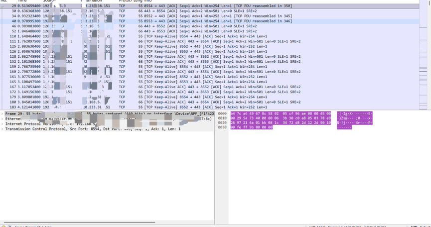

## 二、QQ 通信是加密还是明文？

加密传输。

列表里选中 TLSv1 的 Application Data 那一帧，下层展开仍然是 TCP，帧信息显示一共 89 字节。右下十六进制区是一串散乱的字节，看不出什么规律。

展开任意 TLS 包，Encrypted Application Data 字段为随机十六进制乱码，右侧 ASCII 列全为点或不可读符号，无法读取任何内容。

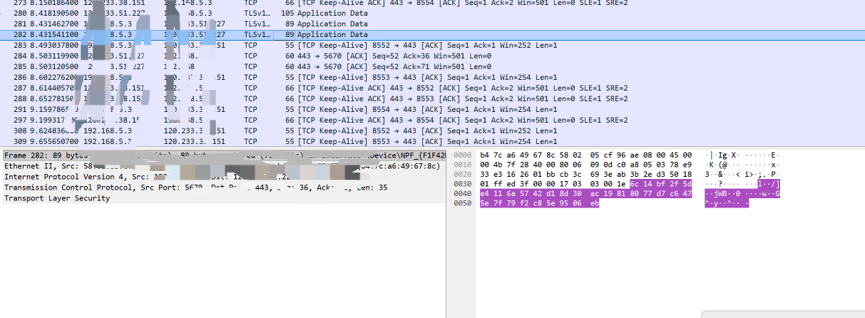

## 三、能否恢复明文传输的文件？

可以，操作如下：

电脑和手机连接相同的 WiFi，并在手机上查看自己的 IP 地址。

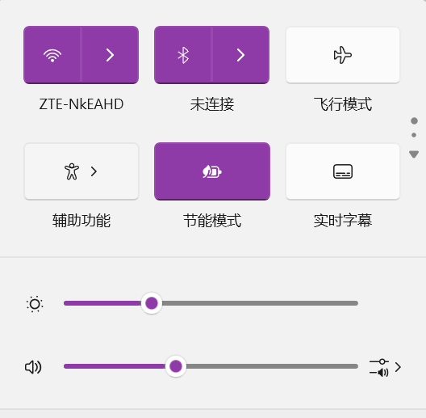

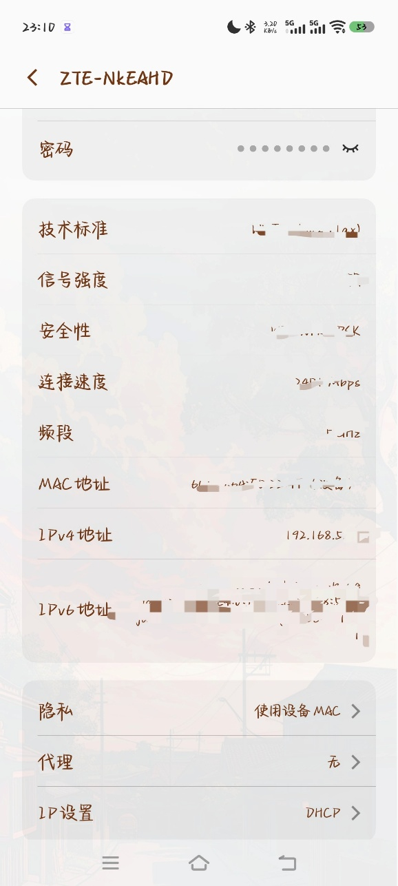

打开 Wireshark，选择 WiFi 开始抓包。

在手机 QQ 上给电脑 QQ 发送图片信息。

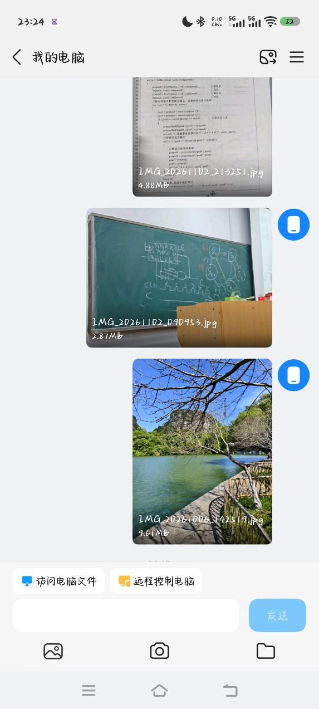

停止抓包，过滤器输入 ip.src == 自己手机 IP 地址。

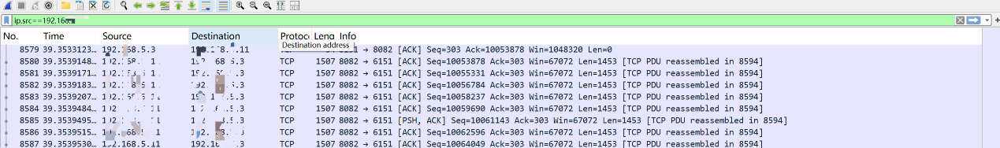

可以看到一个 HTTP 协议的数据包，右键 → 追踪流 → TCP Stream。

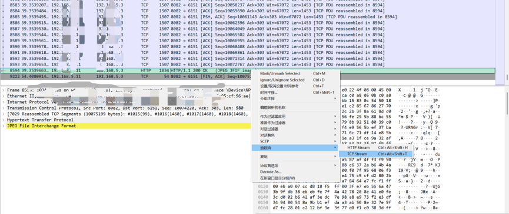

选择原始数据，并保存下来。

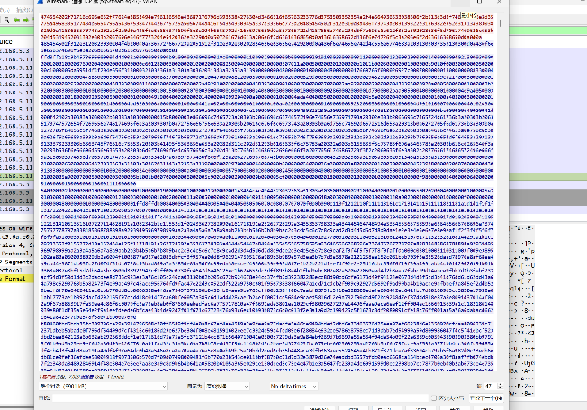

用 010 Editor 打开保存好的文件，并以十六进制搜索 FF D8 FF（图片的头部特征码）。

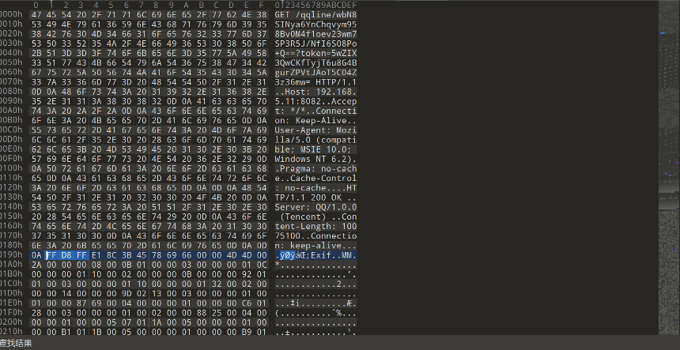

删掉头部特征码前面的内容，并保存文件。

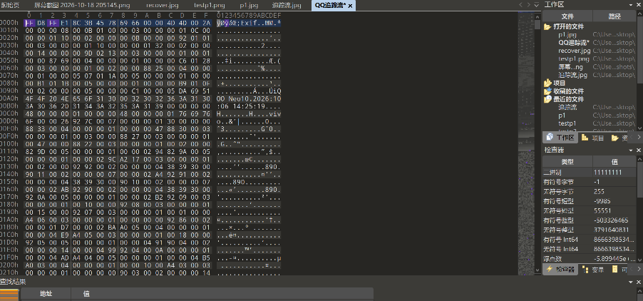

将文件的后缀改为 .jpg，即可将图片复原。

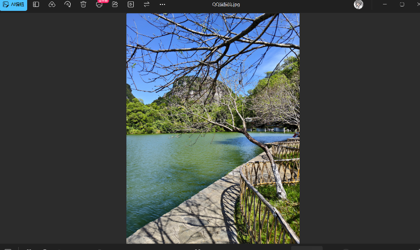
