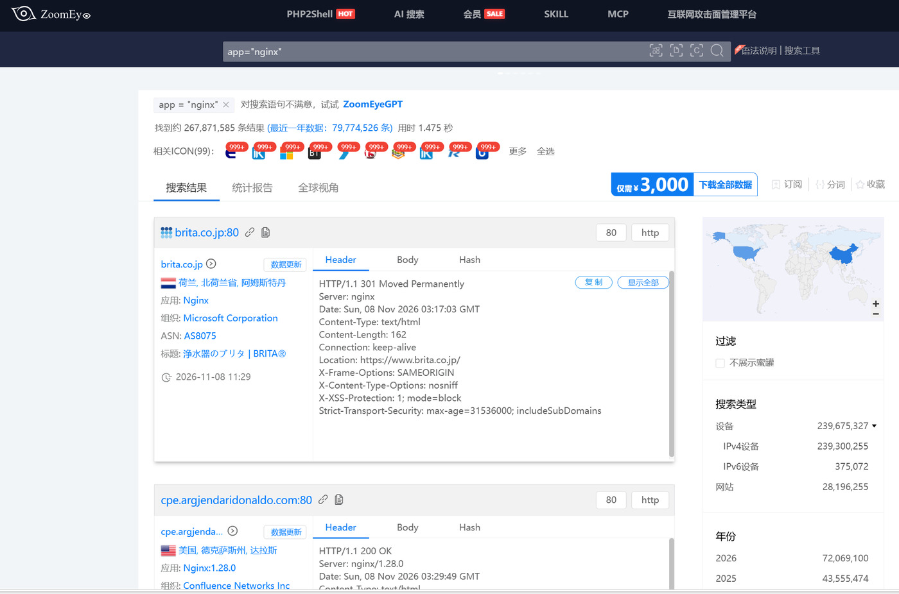
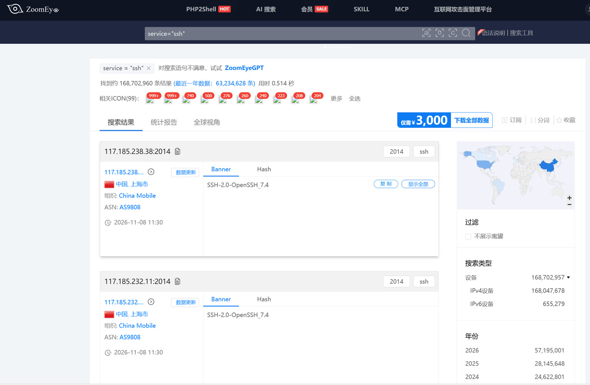
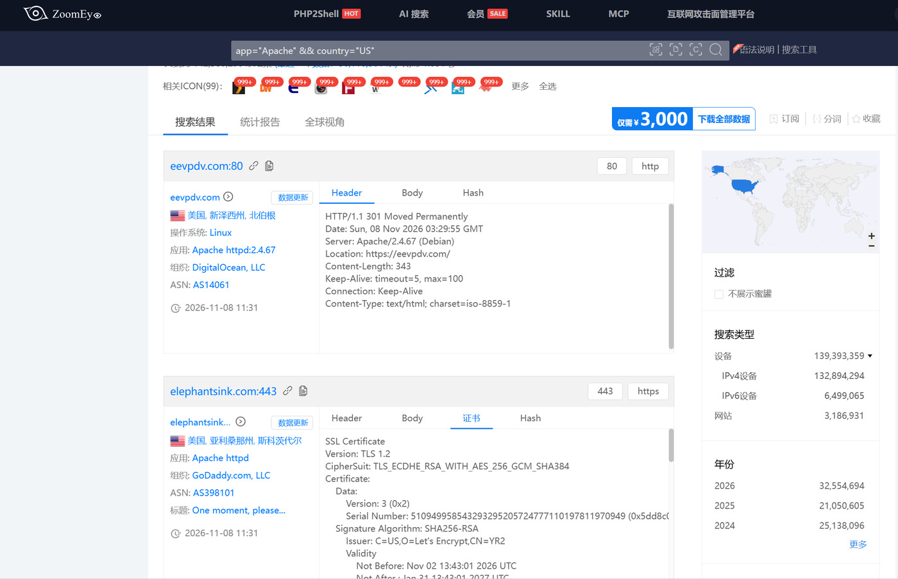

被动扫描也叫被动信息收集，指不直接向目标主机发探测包，而是从第三方已经整理好的公开数据里了解目标。这样做不会在目标的日志里留下痕迹，也不容易触发告警；缺点是数据由别人采集，可能不是最新状态，别人没收录的资产也看不到。本次实验用到的 ZoomEye和 DNS 聚合平台都属于这一类。

ZoomEye 中文名叫“钟馗之眼”，是知道创宇做的网络空间搜索引擎，被叫作国产的 Shodan。它用分布在全球的探测节点不间断扫描 IPv4、IPv6 地址和域名库，把每个 IP 开放的端口、服务返回的 Banner、网站用的组件和版本、SSL 证书、地理位置等记录下来，做成可以按条件检索的库。我们在页面上搜索时查的是它已经存好的数据，并没有自己去扫目标，属于被动收集。

## 一、与ZoomEye功能类似的搜索引擎

功能相近的还有几个。

①Shodan 出现得最早，偏重主机层面，抓的是端口和原始 Banner，服务器、摄像头、工控设备都能查到；

②Censys 偏重证书和 TLS 信息，用一张证书反查同证书下的其他域名很方便；

③FOFA 是国内华顺信安的产品，语法灵活，还能用网站图标的 hash 找出用了同一套系统的站点；

④360 Quake 协议解析比较深，物联网和工控设备的信息更全。

它们做的事情本质上一样，都是先全网测绘再提供检索，只是侧重点和数据覆盖不同。实际做信息收集一般不会只用一个平台，几个交叉查一遍、把结果合并去重，漏掉的会少很多。

## 二、用ZoomEye进行相关搜索

用之前需要先注册登录，免费账号每天有查询次数限制。

搜索框里可以直接输关键词，比如 nginx、WordPress，也可以用“字段="值"”的形式精确过滤，值要加引号。常用的字段有 app（应用组件）、port（端口）、service（服务或协议）、device（设备类型）、os（操作系统）、country 和 city（地理位置）、domain 和 hostname（域名、主机名）等。结果列表里能看到 IP、端口、服务及版本、组件、国家和最后更新时间，点开某一条还能看更详细的信息。

多个条件可以组合：&& 表示且，|| 表示或，!= 表示排除，括号用来改变优先级。下面按实验要求分别试了几种。

搜索框右上方的语法说明可以查寻相关的搜索语法


### 1.按应用组件搜索

按组件检索用 app 字段。比如 app="Nginx" 可以找出用了 Nginx 的站点，再加一个条件就能缩小范围，像 app="Apache" && country="US"。这种方式适合在某个组件爆了漏洞之后，看看公网上有多少站点在用这个组件，估计一下影响范围。

```
app="Nginx" 
```



观察结果页，可以看到查找到的结果有多少条、用时多久。每条左上角显示了域名及端口。第一条 brita.co.jp 开的是 80 端口，Header 里写着 Server: nginx，更新时间 为2026-11-08 11:29；第二条的 Header 里还能看到 Nginx1.28.0 这个具体版本。右边按设备、IPv4/IPv6、网站和年份分开统计，地图上标出了分布。一页里获得的信息不只是 IP，还有组件版本、归属和位置等。

### 2.按特定服务搜索

按服务找可以用 service 或 port。service="ssh" 找的是跑 SSH 服务的主机，port="22" 找的是开了 22 端口的主机，两者不完全等价：服务有时会被改到非标准端口，只看端口会漏；反过来一个端口上也可能跑着别的服务。所以找具体服务优先用 service，看端口开放情况才用 port。类似的还有 service="http"、port="3306"。

```
service="ssh"
```



### 3.组合搜索

把几个条件用 && 连起来就能缩小范围。比如 app="Apache" && country="US" 找的是美国的 Apache 站点，app="nginx" && port="8080" && country="CN" 则是国内开在 8080 上的 nginx。条件加得越多越精确，但也容易一条都搜不到，一般先宽后窄，慢慢加。另外要注意结果里的时间，测绘数据定期更新，不能当成实时扫描的结果。

```
 app="Apache" && country="US"
```



## 三、子域名收集

test、dev、admin、api、mail、vpn 这些子域名常指向测试环境或管理后台，防护比主站弱，是重点要找的。

常用的来源有这几个，都是查公开记录，不用碰目标：

①证书透明日志：网站申请 HTTPS 证书时域名会记进公开日志，在 crt.sh 搜 %.example.com 就能查到一批子域名；

②搜索引擎语法：比如 site:example.com -www，只看这个域名下被收录的页面，挑出子域名；

③DNS 聚合平台：DNSdumpster、VirusTotal、SecurityTrails 存着历史解析记录，已下线的子域名也能翻出来；

④ZoomEye：用 domain="qq.com" 反查这个域名下登记过哪些资产。

下面是在crt.sh上搜索的示例：

```
%.qq.com
```


可以看到这些2017年就已过期的旧证书不仅绑定了主域名（如 `file.mc.qq.com`），还顺带暴露了腾讯内部许多其他的子网站（比如涉及图片、静态资源的域名），并且能看到它们是由Symantec颁发的。

能查到多少取决于平台收录过什么，自己几乎不产生流量；但数据不一定最新，同一个目标最好多换几个来源对一对。
