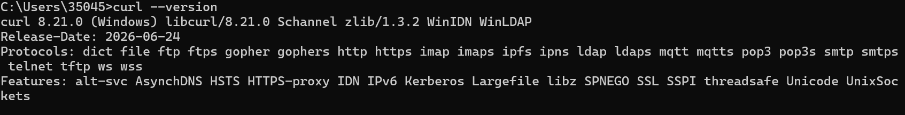
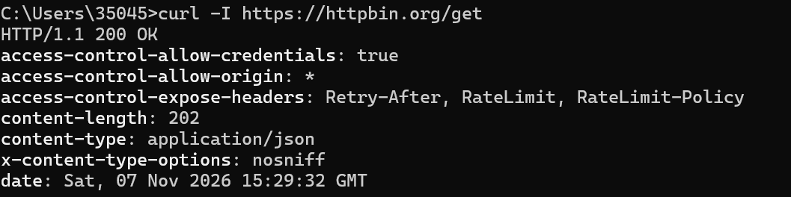
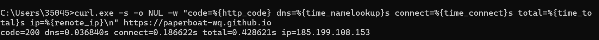
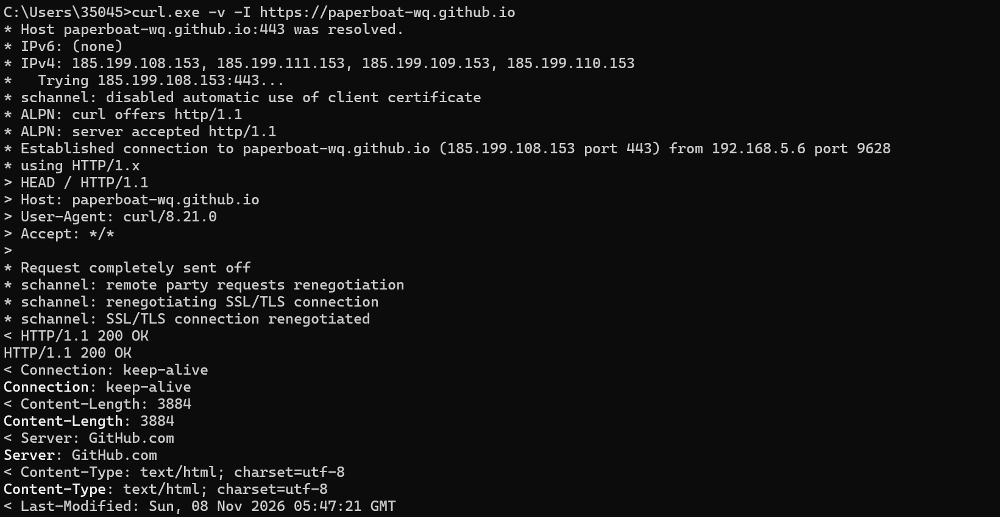
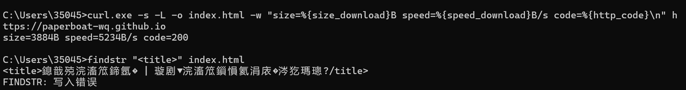

## 什么是 curl

curl 的全称是 Client URL，是一个命令行工具，可以用来在本地和网络服务器之间传输数据。它支持 HTTP、HTTPS、FTP 等二十多种协议，平时常用来调试接口、排查网络问题，也可以写在脚本里面自动获取网络数据。不需要打开浏览器，只需要在终端敲命令就能发送网络请求。

## 准备工作

我使用 Windows 11，打开 cmd。现在新版 Windows 系统自带 curl，不用额外下载安装。

先输入这条命令，确认 curl 可以正常运行：

```
curl --version
```

如果正常，终端会输出版本信息，以及它支持的各类协议；如果提示找不到命令，就代表当前环境无法使用。



*图1：版本 8.21.0，下面列出它支持的协议。*

## 尝试不同 curl 命令

1. **普通 GET 请求**

直接访问测试网站，默认发送 GET 请求，网站会返回收到的请求信息。

```
curl https://httpbin.org/get
```

返回结果里能看到我的访问 IP、请求头，还能看出这次请求来自 curl。

2. **只获取响应头**

加上 `-I` 参数，不会返回网页全部内容，只拿服务器的头部信息，可以快速判断网站能不能访问成功。

```
curl -I https://httpbin.org/get
```

如果出现 `200 OK`，就代表访问成功。



*图2：`HTTP/1.1 200 OK` 和下面几行响应头。*

3. **POST 请求提交数据**

使用 POST ，向接口提交一组数据。

```
curl -X POST -d "number=20260001&name=张三" https://httpbin.org/post
```

测试网站会把提交的数据原样返回，证明数据已经发送成功。

4. **用 -w 看一次请求花了多久**

前面 `-I` 只能看出通不通，加 上`-w` 可以按自己定的格式把状态码和消耗的时间显示出来。

```
curl.exe -s -o NUL -w "code=%{http_code} dns=%{time_namelookup}s connect=%{time_connect}s total=%{time_total}s ip=%{remote_ip}\n" https://paperboat-wq.github.io
```

这次的结果是 `code=200 dns=0.036840s connect=0.186622s total=0.428621s ip=185.199.108.153`。DNS 解析、建立连接、总耗时分开列，慢在哪一段能直接看出来；`-o NUL` 是把网页内容丢掉，只留这一行结果。



*图3：-w 输出的几个数值，以及连接到的真实 IP。*

5. **用 -v 看完整通信过程**

`-v` 会把发出去和收回来的内容全部打出来，`*` 开头的是连接和 TLS 的信息，`>` 是请求头，`<` 是响应头。

```
curl.exe -v -I https://paperboat-wq.github.io
```

图里能看到先解析出 4 个 IP，再连到 185.199.108.153 的 443 端口，ALPN 协商出 http/1.1，然后是 schannel 的 SSL/TLS 握手，最后服务器回 `HTTP/1.1 200 OK`，还有 `Server: GitHub.com`、`Content-Type: text/html; charset=utf-8`。



*图4：DNS、TLS 握手、请求头和响应头都在这里。*

6.**用 -o 把网页存下来再核对内容**

`-o` 是下载到本地文件，`-w` 顺带打出大小和速度，之后不用浏览器也能查文件里的内容。

```
curl.exe -s -L -o index.html -w "size=%{size_download}B speed=%{speed_download}B/s code=%{http_code}\n" https://paperboat-wq.github.io
findstr "charset" index.html
```

这次存了 3884 字节、返回 200，速度每次跑都不一样。一开始我写的是 `findstr "<title>"`，结果中文全成了乱码，还报了 `FINDSTR: 写入错误`；查过资料之后我才知道网页是 UTF-8，cmd 默认用的是 GBK 代码页，findstr 把中文按错的方式解了。改成找纯英文的 `charset` 那行就不会有这个问题。



*图5：下载成功，但 出现了乱码和写入错误，就是前面说的编码问题。*

## 常用参数

- `-I`：只获取响应头部
- `-X`：指定请求方式
- `-d`：携带需要提交的数据
- `-O`：下载线上文件保存到电脑
- `-v`：输出详细通信过程，方便找错误
- `-L`：跟随重定向，一直拿到最终页面
- `-H`：自定义请求头
- `-w`：按指定格式输出状态码、耗时这些信息
- `-o`：把返回内容存成指定的文件
- `-s`：安静模式，不显示进度条

