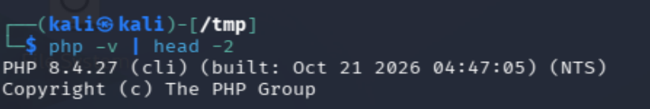
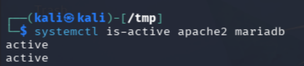
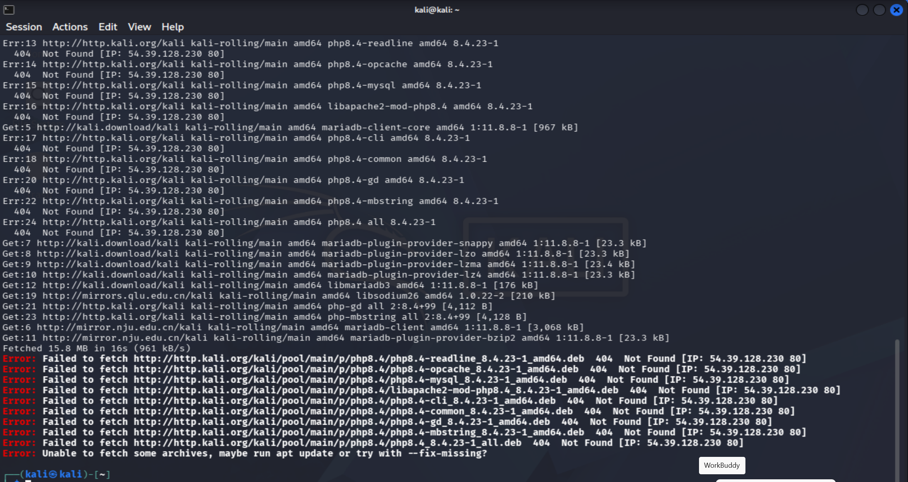
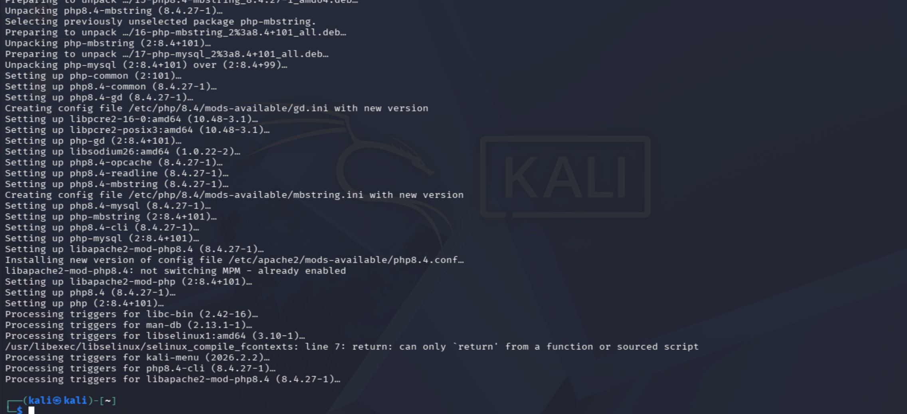
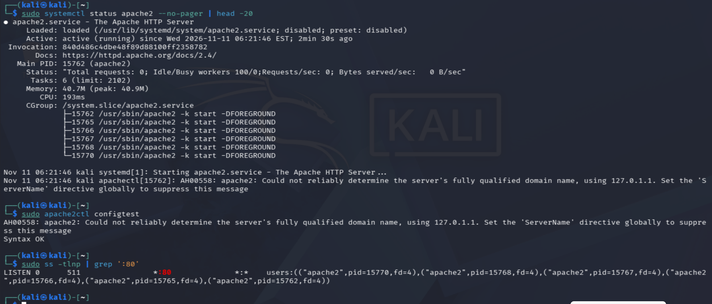
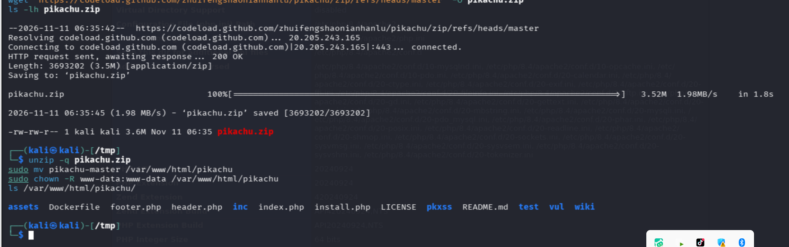
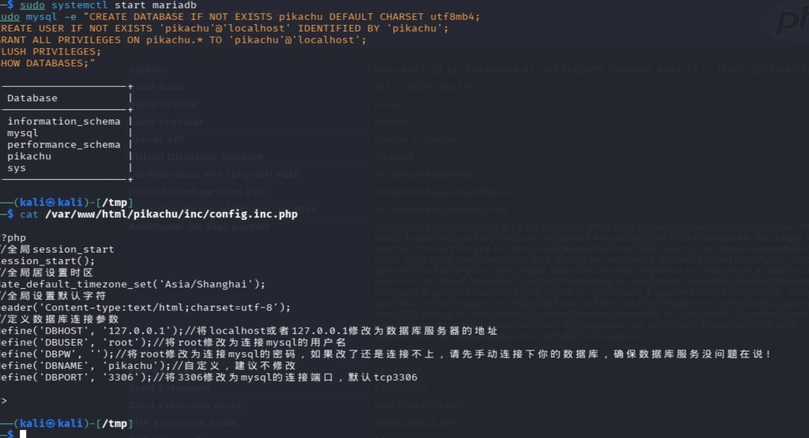
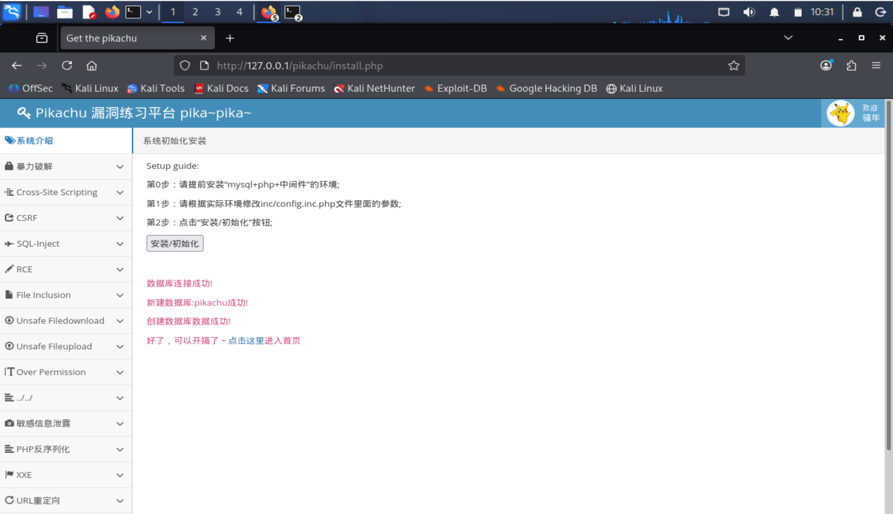
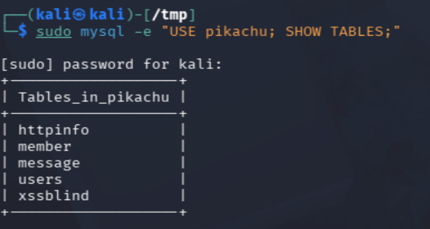
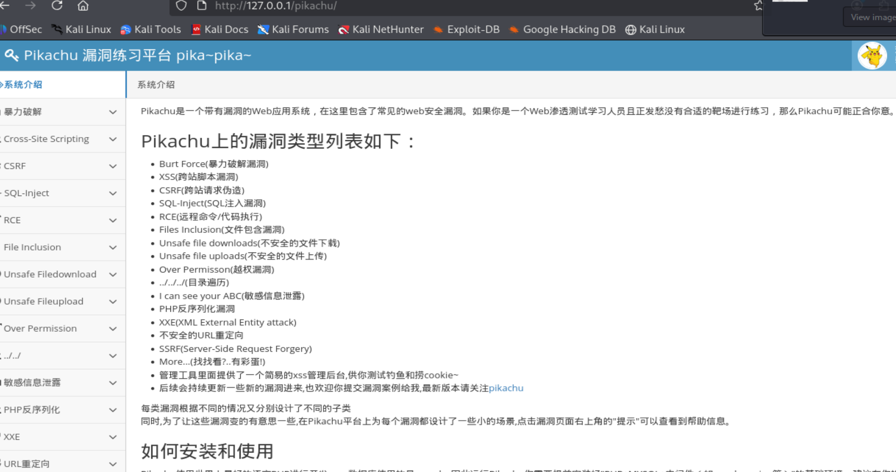

Pikachu 是一个用 PHP 写的 Web 漏洞练习平台，按漏洞类型分成十几个模块：暴力破解、SQL 注入、XSS、文件包含、命令执行等等。每个模块里既有原理说明，也有一个可以动手的页面。

它要跑起来需要三样东西：Web 服务器（Apache）、PHP 解释器、数据库（MySQL）。这个实验就是把组件装上、代码放进去、数据库建好、配置改对、初始化跑一遍。

我这里把Pikachu装在 Kali 虚拟机里，没装在 Windows 上。Windows 那里一般用小皮面板点鼠标就行，但 Web 渗透的题基本都在 Kali 里做，Burp Suite 也自带，靶场和工具放在同一个系统里省的来回切换。

## 准备工作

先检查kali 上已经有的配置。Kali 是 2026.1，PHP 8.4.27 已经有了，apache2 和 mariadb 也都在跑。因为我前面已经配置过 Apache，下面这步主要是把 PHP 的扩展补齐。

```
php -v | head -2
systemctl is-active apache2 mariadb
```



*图1：PHP 8.4.27。*



*图2：两个服务的状态，都是 active。*

1. **装 Apache、PHP 和数据库**

```
sudo apt update
sudo apt install -y apache2 mariadb-server php libapache2-mod-php php-mysqli php-gd php-mbstring
```

我这里出现报错，全是 `php8.4` 的几个包，而 mariadb 那些都下载成功了。404 不是表示连接不上，而是说“你要的这个文件不存”。

原因是 Kali 是滚动更新的，仓库里的软件一直在换版本。本机索引记的是 `php8.4 = 8.4.23-1`，而官方源上的那个版本已经被替换掉了，按老路径去要就会出现 404。需要刷新索引再装一次：

```
sudo apt update
sudo apt install -y php libapache2-mod-php php-mysqli php-gd php-mbstring
```



*图3：php8.4 的几个包下载 404。*

看到 `Setting up php (2:8.4+101)` 就表示装完了。



*图4：PHP 装好。*

装完重启 Apache 让模块生效，顺便设成开机自启：

```
sudo systemctl restart apache2
sudo systemctl enable apache2 mariadb
```

2. **确认 Apache 在跑**

```
sudo systemctl status apache2 --no-pager | head -5
sudo apache2ctl configtest
sudo ss -tlnp | grep ':80'
```

这三条指令的意思分别是：服务在不在跑、配置语法对不对、80 端口有没有人在听。前两条正常的话会看到 `active (running)` 和 `Syntax OK`。



*图5：running、Syntax OK，80 端口在监听。*

3. **下载靶场源码**

```
cd /tmp
wget "https://codeload.github.com/zhuifengshaonianhanlu/pikachu/zip/refs/heads/master" -O pikachu.zip
unzip -q pikachu.zip
sudo mv pikachu-master /var/www/html/pikachu
sudo chown -R www-data:www-data /var/www/html/pikachu
```



*图6：目录里有 index.php、install.php、inc、vul。*

4. **建数据库**

```
sudo systemctl start mariadb
sudo mysql -e "CREATE DATABASE IF NOT EXISTS pikachu DEFAULT CHARSET utf8mb4;
CREATE USER IF NOT EXISTS 'pikachu'@'localhost' IDENTIFIED BY 'pikachu';
GRANT ALL PRIVILEGES ON pikachu.* TO 'pikachu'@'localhost';
FLUSH PRIVILEGES;
SHOW DATABASES;"
```

最后一句会把所有库列出来，里面有 `pikachu` 就表示对了。



*图7：数据库列表里有 pikachu。*

5. **改配置文件**

因为 Apache 是用 www-data 身份跑的，用它连接数据库时无法使用 root（Kali 的 root 只认系统 root 用户），所以第 4 步新建一个pikachu 账号；而靶场代码里固定写的是 root、密码为空，所以这里要把配置改成 pikachu。主站和 pkxss 是两套代码，各读各的配置，两个文件都要改： 

```
sudo sed -i "s/define('DBUSER', 'root')/define('DBUSER', 'pikachu')/" /var/www/html/pikachu/inc/config.inc.php
sudo sed -i "s/define('DBPW', '')/define('DBPW', 'pikachu')/" /var/www/html/pikachu/inc/config.inc.php
sudo sed -i "s/define('DBUSER', 'root')/define('DBUSER', 'pikachu')/" /var/www/html/pikachu/pkxss/inc/config.inc.php
sudo sed -i "s/define('DBPW', 'root')/define('DBPW', 'pikachu')/" /var/www/html/pikachu/pkxss/inc/config.inc.php
```

主站默认密码是空、pkxss 默认是 root，四条 sed 不能照抄成同一条，匹配不上时 sed 不报错

6. **初始化**

浏览器打开 `http://127.0.0.1/pikachu/install.php`，点页面中间的「安装/初始化」，它会自动建表、插初始数据。



*图8：四条红字提示，建表成功。*

页面提示「好了，可以开搞了」，下面有链接进首页。

7. **验证**

先看表建出来没有：

```
sudo mysql -e "USE pikachu; SHOW TABLES;"
```

应该列出 `httpinfo`、`member`、`message`、`users`、`xssblind` 五张表。



*图9：五张表。*

再打开 `http://127.0.0.1/pikachu/`，左侧十几个模块都能点进去，中文正常，没有报错刷屏。



*图10：皮卡丘首页，左侧是漏洞菜单。*

---

## 容易搞混的地方

`127.0.0.1` 指的是「我这台机器」。在 Windows 的浏览器里敲它，访问的是 Windows 本机，跟虚拟机里的 Apache 没关系。要么在 Kali 里开浏览器，要么用 Kali 的地址 `http://192.168.200.131/`。

## 常用命令

- `sudo apt install -y apache2 mariadb-server php libapache2-mod-php php-mysqli`：装 LAMP
- `sudo systemctl enable apache2 mariadb`：设开机自启
- `sudo apache2ctl configtest`：检查配置语法
- `sudo ss -tlnp | grep ':80'`：看 80 端口谁在听
- `sudo chown -R www-data:www-data 目录`：改属主，让 Web 进程能写
- `sudo mysql -e "..."`：在命令行执行 SQL
- `sudo sed -i "s/旧/新/" 文件`：直接替换文件内容
